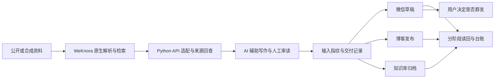

# 个人知识检索与内容交付工作流

## 问题与目标

我希望把阅读资料用于检索、问答和内容创作，同时能回答：这段判断来自哪里？哪一步已经成功？请求超时以后能否接着做？私人材料有没有进入外部模型？

单次生成文章并不能解决这些问题，因此我把知识库、AI 写作、平台交付和人工终审分开处理。

## 组件与分工

技术以 Python、现有 WeKnora 产品、模型／Agent 工具和平台 API 为主。原生解析、混合检索、精排、Wiki、标签和问答来自 WeKnora；我的工程工作主要是适配、范围校验、来源回查、内容流程和交付恢复。博客依赖既有 CMS。

## 关键实现与取舍

- **精确范围要检查回包。** 文档级检索与库级检索的参数语义可能不同；除了正确构造请求，还检查命中的文档和库身份，避免“请求成功但范围扩大”。
- **原文重建不靠拼接猜测。** 按字符偏移处理重叠分块，遇到缺口、冲突或正文缺失就报错，避免拼出不存在的原文。
- **检索失效不能解释为空结果。** 模型／精排状态与合法无匹配分开，依赖异常时停止相关交付。
- **超时不是失败的证据。** 创建草稿前持久化输入指纹与阶段记录；超时后先回查唯一匹配，结果仍不确定就不重复创建。
- **交付状态分别记录。** 微信草稿、博客公开、知识库归档和本地台账可部分成功；恢复时复用原身份和内容，不重新生成整批。
- **应用过滤不等于权限隔离。** 对私有材料的自动脱敏尚未验收，不能因为存储自建就假定数据不经过外部模型。

上述机制降低重复创建和状态混淆的风险，不构成对外部平台严格 exactly-once 的保证。

## 个人职责与 AI 协作

我负责目标、流程边界、架构取舍、问题定位、审阅与验收，使用 AI 协作实现脚本、测试和文档。面试中我需要能解释具体数据流、失败行为和验证依据；不把 AI 产出等同于我已熟练掌握所有实现细节。

## 状态与限制

项目有本地源代码、回归文件及历史真实交付记录。最新本地进度记录每日写稿在 2026-11-03 暂停；本次作品集整理没有重新访问生产或触发交付。私人材料自动脱敏、真实读者效果和无凭据复现仍有缺口。

本公开案例没有原始文章、私人知识、平台账号、配置和真实台账。合成演示的方案见[演示设计](../examples/synthetic-demo-plan.md)，当前尚不是可运行 demo。
