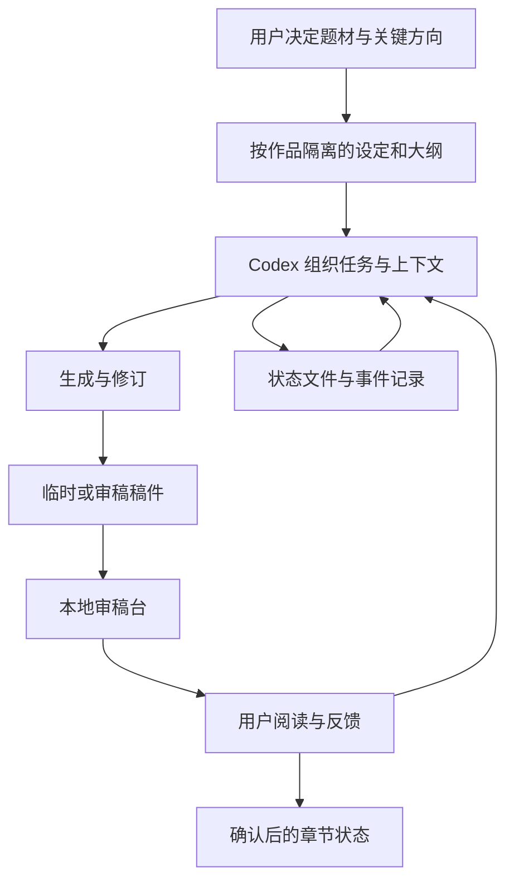

# 多作品创作与本地审稿台

## 问题与目标

长篇生成很容易出现人物、设定和时间线漂移。一次性生成大量章节，也让用户难以判断应该从哪里修改。我把创作拆成目标、上下文、草稿、审稿、反馈和确认后的状态，让人保留最终创作决定。

## 架构

本地站点使用 Node.js 原生 HTTP 与文件接口，前端是 HTML、CSS 和 JavaScript，启动脚本兼顾 Windows 和 Shell。模型调用脚本采用任务 JSON、指定输入文件和提示词快照，不依赖复杂框架。

不同作品有不同生产策略：已有作品使用 Codex 管理流程、DeepSeek API 执行正文任务；另一作品使用 Codex-only。审稿台负责读稿、反馈和状态，不在页面后台静默调用付费生成，也不自动发布。

## 关键机制

- 每部作品的设定、人物、大纲和稿件独立存放，避免上下文串台。
- 正式设定与临时推演分开；候选内容经确认后才能进入 canon。
- 任务只指定需要的上下文和输出位置，不把整个仓库无差别送给模型。
- 稿件、反馈、状态与事件共同记录进度，会话结束后可以从文件恢复。
- 草稿、修订与确认后的状态有明确入口；上传平台记录事件，不冒充作品质量状态。
- 审稿台监听本机回环地址，属于个人本地工具；尚不具备公网多用户产品的认证与隔离能力。

## 个人职责与 AI 协作

我决定创作方向、流程和验收规则，AI 协作完成应用代码、上下文整理和草稿。用户审稿提供最终反馈。多轮同模型自审仍是自审，不称为外部独立审稿。

## 已有内容与本次核验

项目有实际服务端、前端、生成脚本和文档，不只是概念。历史记录包含本地审稿 API 验证及章节流转样本；本次只检查源码和 Node.js 语法，没有启动站点、调用模型或读取私人稿件，所以不声称今天已完成全链路运行验收。

公开演示拟使用完全新写的短故事和合成反馈，演示从草稿到用户意见，再到修订与中断恢复。原小说、参考作品全文、大纲和真实提示词快照不在本包中；可运行的合成版本尚未实现。
