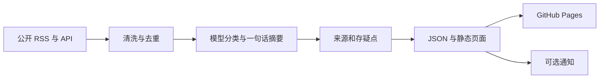

# Easton Radar：公开信息简报

已有公开仓库：[huadongpeng/easton-radar](https://github.com/huadongpeng/easton-radar)。2026-11-10 实际检查仓库页，显示 Public，可以查看 README、源码、测试和工作流目录。

这个项目把公开信息源的采集、清洗、模型分类与摘要、证据入口和静态展示接成一条流程。技术以 Python、模型与搜索 API、GitHub Actions 和 GitHub Pages 为主，通知是独立输出。

与内容创作项目相比，它的职责更窄：提供外部变化与事实入口，不自动生成公众号正文，也不把二手线索直接当作确定事实。我的工作重点是信息源选择、流程约束、API 编排、产物组织和 AI 协作实施。

现有公开源码可以接受技术审阅。完整运行仍依赖用户自行提供模型及搜索服务凭据，可能产生调用费用；本次没有触发 Actions、发送通知或核验连续运行，不能把“有定时 workflow”写成“已证明长期稳定”。离线合成 fixture 演示仍待补充。
